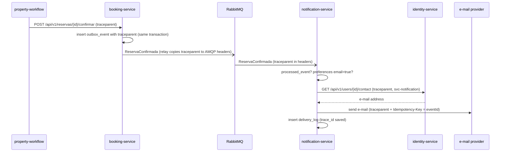

# CP1 · Journey: the guest gets the confirmation e-mail

When the Saga confirms a `Reserva`, `booking-service` writes `ReservaConfirmada` to its
outbox. `notification-service` consumes it from RabbitMQ, checks the guest's
preferences, gets the e-mail address and sends the message. Notification is almost only
an event consumer: its only REST surface is `GET/PATCH /api/v1/preferencias`
(`07-api/contracts/notification-endpoint-fiches.md`).

**Open decision used here.** GAP-017 (`07-api/gaps.md`): Notification has no way yet to
get the guest's e-mail. One of the two options in the gap is an internal read to
Identity with a service credential. This map assumes that option:
`GET /api/v1/users/{id}/contact` (service token `svc-notification`), still to be added to
`identity-service.yaml`.

## Hops

| Step | Caller | Callee | Protocol | Operation | Sync/Async | Data |
|---|---|---|---|---|---|---|
| 1 | `property-workflow` | `booking-service` | REST | `POST /api/v1/reservas/{id}/confirmar` (E-18) | sync | `booking.reservation` + `booking.outbox_event` |
| 2 | outbox relay (`booking-service`) | RabbitMQ | AMQP | publish `ReservaConfirmada` | async | `booking.outbox_event` |
| 3 | `notification-service` | RabbitMQ | AMQP | consume `ReservaConfirmada` | async | `notification.processed_event` (skip duplicates by `eventId`) |
| 4 | `notification-service` | PostgreSQL | SQL | read `notification.notification_preference` of the guest | sync | `notification_preference` |
| 5 ⚑ | `notification-service` | `identity-service` (:3004) | REST | `GET /api/v1/users/{id}/contact` (GAP-017 option) | sync | `identity.user_account` |
| 6 | `notification-service` | e-mail provider | HTTPS | send the message from `notification.message_template` | sync | external |
| 7 | `notification-service` | PostgreSQL | SQL | insert `notification.delivery_log` | sync | `delivery_log` |

⚑ Hop 5 is the one of the CP9 drill: its downstream is `identity-service`.

## Sequence

How the context travels:

- Booking keeps `traceparent` in the outbox row, the relay puts it in the AMQP message
  headers. Without that column the trace dies at the outbox.
- The consumer reads it from the headers and opens a **child span** with the same
  `trace_id`; every log line of the delivery carries it.
- Calls to Identity and to the e-mail provider send `traceparent`. To the provider we
  also send `Idempotency-Key = eventId`, so a redelivered event never sends two e-mails.
- `delivery_log` stores the `trace_id`, so a guest's complaint ("I never got the
  e-mail") can be followed back to the Saga.

## Span tree

- `saga reservar` — property-workflow (root, starts in the Saga of the guest)
  - `POST /api/v1/reservas/{id}/confirmar` — booking-service
    - `insert outbox_event` — booking-service
- `relay publish ReservaConfirmada` — booking-service (**async boundary, same trace_id**)
  - `consume ReservaConfirmada` — notification-service
    - `check processed_event` — notification-service
    - `select notification_preference` — notification-service
    - `GET /api/v1/users/{id}/contact` — identity-service
    - `send e-mail` — e-mail provider (external)
    - `insert delivery_log` — notification-service
