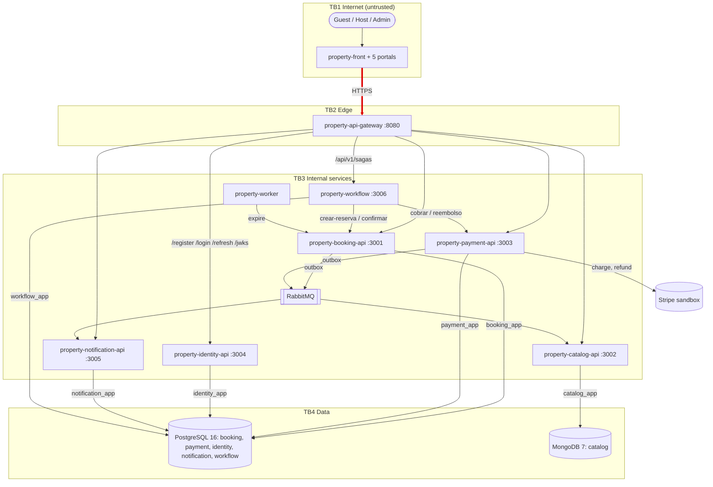

# CP1 — Attack surface of Property

Sources: property-docs 05-architecture/overview.md, 05-architecture/deployment.md and the
OpenAPI contracts in 07-api/contracts/. My boundary, in red: **internet -> api-gateway (identity public routes)**.

## Assets of my boundary

| Asset | Where it lives | Classification |
|---|---|---|
| E-mail and password of the user | body of POST /register and /login | restricted |
| Access token (JWT RS256, roles GUEST/HOST/ADMIN) | answer of /login and /refresh; Authorization header | restricted |
| Refresh token | answer of /login; stored as a hash in identity.refresh_token | restricted |
| Public key set | GET /api/v1/jwks | public |
| Account lock state (failed_logins, locked_until) | identity.user_account | internal |

## Entry points of my boundary

| Entry point | Who calls it | Authentication today |
|---|---|---|
| POST /api/v1/login (E-11) | browser, any client | none (public); rate limit 10 per IP in 5 minutes; account lock after 5 failures |
| POST /api/v1/register (E-10) | browser | none (public) |
| POST /api/v1/refresh (E-12) | browser | refresh token in the body |
| GET /api/v1/jwks (E-15) | services, anyone | none (public key only) |
| Port 8080 | internet | the only published port of the platform |
